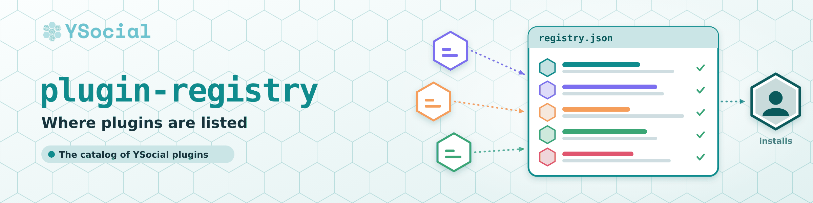

# YSocial plugin registry

<p align="center">
  
</p>

> The public catalog of plugins that the YSocial plugin page can install.

<p align="center">
  <a href="https://github.com/YSocialTwin/YSocial"><b>YSocial</b></a> &nbsp;·&nbsp;
  <a href="https://y-not.social/plugins">Plugins</a> &nbsp;·&nbsp;
  <a href="CONTRIBUTING.md">Add your plugin</a> &nbsp;·&nbsp;
  <a href="#format">Format</a> &nbsp;·&nbsp;
  <a href="https://y-not.social/">Website</a>
</p>

<p align="center">
  <a href="https://github.com/YSocialTwin/plugin-registry/actions/workflows/validate.yml"></a>
  <a href="https://www.gnu.org/licenses/gpl-3.0"></a>
</p>

YSocial reads
[`registry.json`](registry.json) when it starts (and keeps a copy for offline use), so a
plugin listed here becomes available in an **already installed** YSocial, with no new
YSocial or installer release.

Each entry points to a GitHub repository; the registry does not host any code.

## Two files, one source of truth

| File | What it lists | How YSocial uses it |
| --- | --- | --- |
| [`builtin.json`](builtin.json) | The plugins that ship with YSocial (simulation runtimes, memory, ...), with everything YSocial needs to install and validate them | Copied into each YSocial release (`scripts/packaging/sync_builtin_plugins.py` in YSocial) and read from the package, **never fetched at run time**. A registry entry can never redefine one of them |
| [`registry.json`](registry.json) | Every other plugin | Fetched when YSocial starts (cached for offline use) and added to the built-in ones |

This repository is the only place where plugins are described. YSocial keeps a generated copy of
`builtin.json` (it records the commit it comes from and a hash, and its tests and release job fail if
it is edited by hand or is behind this repository). To change a built-in plugin: edit `builtin.json`
here, then run the sync script in YSocial and release.

## Trust levels

| Level | Meaning | What the user sees |
| --- | --- | --- |
| `official` | Maintained by the YSocial team (repositories of the `YSocialTwin` organisation only) | Installs like the built-in plugins |
| `community` | Anyone else | A "Community" badge, a warning with the repository link and an explicit confirmation before install/update |

`trust: official` is ignored by YSocial for any other owner, so an entry cannot give itself
that status.

## What an entry can and cannot do

* It names a repository (`owner/name`) and a branch. The clone URL is always built by
  YSocial from those two values.
* It picks an install **recipe** by name (`auto`, `requirements`, `pip-editable`); it cannot
  carry commands. Installing still runs the plugin's own code (`pip install` executes
  `setup.py`), which is why community plugins ask for confirmation.
* Malformed entries are skipped by YSocial; plugins that ship with YSocial always win on a
  clash of `id`, repository or directory.

## Add your plugin

See [CONTRIBUTING.md](CONTRIBUTING.md). In short: open a pull request that adds one object
to `registry.json`; CI checks the format and that your repository is reachable and has a
`meta/info.json`.

## Format

[`registry.schema.json`](registry.schema.json) and [`builtin.schema.json`](builtin.schema.json) are the JSON Schemas;
`scripts/validate_registry.py` applies the same rules YSocial applies (standard library only) to both files, and
rejects any registry entry whose id, directory or repository is already used by a built-in plugin:

```bash
python scripts/validate_registry.py                # rules
python scripts/validate_registry.py --check-repos  # + repositories exist (uses GITHUB_TOKEN if set)
```

| Field | Required | Notes |
| --- | --- | --- |
| `id` | yes | unique, `^[a-z][a-z0-9_]{2,47}$` |
| `name` | yes | shown in the plugin list |
| `category` | yes | `agent_extensions`, `frontend_extensions` or `backend_extensions` |
| `repo` | yes | GitHub `owner/name` |
| `description` | no | up to 400 characters (used until the plugin's own `meta/info.json` is installed) |
| `branch` | no | default `main` |
| `directory` | no | folder under `external/`, default the repository name |
| `recipe` | no | `auto` (default: detect `requirements.txt` / `pyproject.toml` / `setup.py`), `requirements`, `pip-editable` |
| `trust` | no | `community` (default) or `official` |
| `min_ysocial_version` | no | older YSocial versions do not list the plugin |
| `authors`, `import_name`, `private` | no | `private: true` plugins are shown only with `--development` until the repository is public |
